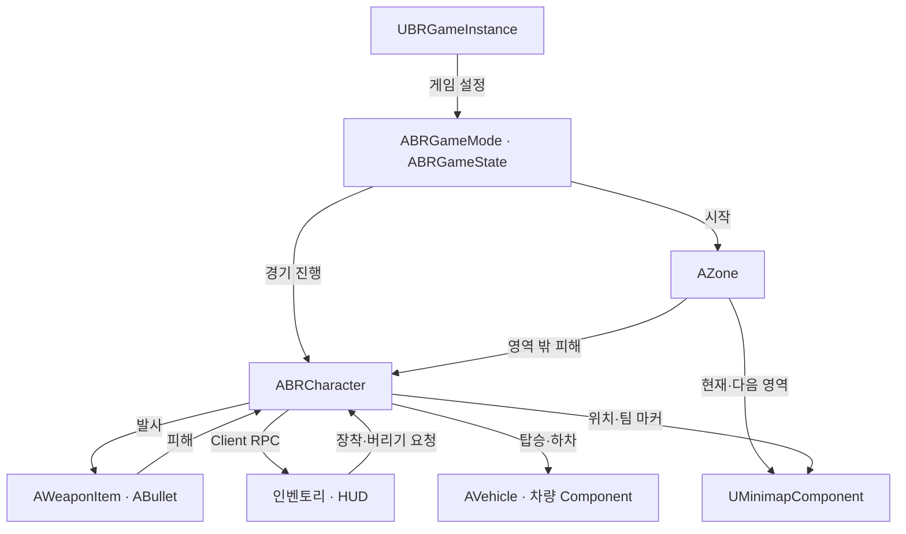

# Battle Royale - Unreal Engine C++ 클라이언트 포트폴리오

> Unreal Engine C++ 기반 멀티플레이 배틀로얄 프로젝트입니다.  
> **서버에서 처리하는 전투·인벤토리와 팀원 소생**, **차량 입력 동기화와 원격 보간**, **단계별 자기장과 지도 표시**를 구현했습니다. 발사·아이템 수량·소생 결과는 서버에서 처리하고, 소유자의 UI와 다른 플레이어에게 보이는 상태를 나눠 갱신했습니다.

---

<a id="table-of-contents"></a>

## 목차

- [1. 프로젝트 개요](#overview)
- [2. 핵심 기술 요약](#tech-summary)
- [3. 시스템 구조](#system-architecture)
- [4. 핵심 기술 상세](#core-tech)
  - [4.1 전투 처리와 상태 복제](#combat-replication)
  - [4.2 차량 입력 동기화와 원격 보간](#vehicle-replication)
  - [4.3 서버 인벤토리와 장비·UI 연동](#inventory-equipment)
  - [4.4 팀원 소생 - 서버의 조건 검사와 완료 판정](#team-revive)
  - [4.5 단계별 자기장과 지도 좌표 변환](#zone-minimap)
- [5. 코드 구조](#code-structure)
- [6. 설계상 트레이드오프](#tradeoffs)

---

<a id="overview"></a>

## 1. 프로젝트 개요

| 항목 | 내용 |
|---|---|
| 프로젝트 | 멀티플레이 배틀로얄 |
| 장르 | 3D 슈팅 / 배틀로얄 |
| 엔진 / 언어 | Unreal Engine / C++ |
| 주요 구현 | 세션 생성·참가, 전투·인벤토리, 장비·애니메이션 연동, 팀원 소생, 차량, 자기장·지도 |
| 플레이 구성 | Solo·Duo·Squad 모드, 비행기에서 낙하 후 전투하는 진행 흐름 |

### 프로젝트 방향

멀티플레이 환경의 기본 구조를 직접 구현하는 것을 목표로, **서버 중심의 게임 상태 관리와 클라이언트 동기화**에 초점을 맞췄습니다.

아이템 획득·전투·팀원 소생 등의 요청은 **Server RPC**로 전달해 서버에서 처리하고, 인벤토리·체력 등 개인 UI는 **Client RPC**로 갱신했습니다. 발사 효과와 일부 애니메이션은 **NetMulticast RPC**로 전달하고, 조준·기절·장비 외형 등의 상태는 <strong>변수 복제(Replication)</strong>로  동기화했습니다.

---

<a id="tech-summary"></a>

## 2. 핵심 기술 요약

| 핵심 기술 | 설명 |
|---|---|
| 전투 처리와 상태 복제 | 서버에서 투사체를 생성하고 충돌에 따른 피해를 처리했습니다. 탄약·조준 등은 복제 대상을 구분하고, 재장전과 장비 전환은 AnimNotify에서 서버 요청으로 연결했습니다. |
| 차량 동기화 | 운전 입력을 서버에 전달하고 위치·회전·속도 상태를 복제했습니다. 다른 플레이어의 차량은 위치와 속도를 이용한 곡선 보간, 회전 보간으로 갱신했습니다. |
| 서버 인벤토리와 장비·UI | 서버가 아이템별 ID·수량·무게를 관리하고, 변경 결과를 소유자의 UI에 전달했습니다. 화면 내 슬롯 정렬과 실제 장비 교체를 구분하고, 무기 소켓과 방어구 Mesh를 갱신했습니다. |
| 팀원 소생 | 서버가 같은 팀인지, 소생 가능한 상태와 거리인지 반복 검사했습니다. 시작 시간을 서버에 기록하고, 조건을 유지한 채 필요한 시간이 지나면 소생을 완료했습니다. |
| 자기장과 지도 | 단계별 축소 속도·대기 시간·피해량을 적용했습니다. 월드 좌표를 지도 좌표로 바꿔 위치와 자기장 범위를 표시하고, 지도 클릭은 월드 위치로 변환해 팀 마커와 연결했습니다. |

---

<a id="system-architecture"></a>

## 3. 시스템 구조



| 클래스 | 역할 |
|---|---|
| `UBRGameInstance` | Online Subsystem을 통한 세션 생성·검색·참가, 게임 설정과 아이템 DataTable 조회 |
| `ABRGameMode` / `ABRGameState` | 게임 시작·종료와 생존 결과 처리, 경기 상태와 플레이어 목록 복제 |
| `ABRCharacter` | 플레이어 입력, 전투·인벤토리·소생의 서버 처리, 소유자 UI와 공유 상태 갱신 |
| `AWeaponItem` / `ABullet` / `UBRAnim` | 발사 주기·탄창, 투사체 충돌·피해, 애니메이션 상태와 Notify 처리 |
| `AVehicle` / 차량 Component | 좌석과 조종 대상 변경, Chaos 차량 입력 적용, 서버 상태 복제·보간 |
| `AZone` / `UMinimapComponent` | 자기장 단계 진행·피해 판정, 지도 위 위치·범위 표시와 클릭 좌표 변환 |

세션 생성이 완료되면 **호스트도 플레이어로 참여하는 리슨 서버**로 맵을 열었습니다. 세션 참가 시에는 접속 주소를 얻은 뒤 해당 서버로 이동하도록 했습니다. 기존 세션이 있으면 새 설정을 보관하고, 세션 제거 완료 콜백에서 다시 생성하도록 순서를 나눴습니다.

경기 진행은 GameMode와 GameState에서 관리했습니다. 비행기 낙하 모드는 `APlaneGameMode`에서 시작 흐름을 확장하고, 낙하 시 저장해 둔 캐릭터를 다시 조종하도록 연결했습니다.

---

<a id="core-tech"></a>

## 4. 핵심 기술 상세

<a id="combat-replication"></a>

### 4.1 전투 처리와 상태 복제

#### 투사체 생성과 피해 처리

발사 입력을 **서버 RPC로 전달하고, 서버의 무기 Actor에서 탄창과 발사 가능 상태를 확인**하도록 했습니다. 자동 사격은 무기별 발사 간격에 맞춘 타이머로 반복하고, 사격을 멈추거나 탄약이 소진되면 타이머를 해제했습니다.

조준 방향으로 Trace해 목표 지점을 구한 뒤, **총구에서 그 지점을 향하도록 투사체를 생성**했습니다. 투사체의 이동은 `ProjectileMovementComponent`가 담당하고, 충돌 시 서버에서 피해를 계산했습니다.

피격된 Bone으로 머리와 방어구 적용 부위를 구분했습니다. 머리에는 기본 피해의 두 배를 적용하고, 해당 부위에 방어구가 있으면 내구도를 먼저 차감한 뒤 남은 피해를 체력에 반영했습니다.

#### 소유자와 다른 플레이어의 갱신 구분

| 정보 | 전달 방식 |
|---|---|
| 보유 탄약 합계 | `COND_OwnerOnly`로 해당 캐릭터의 소유자에게만 복제 |
| 조준·기울이기·활성 장비 슬롯 등 | 소유자의 로컬 처리는 유지하고, `COND_SkipOwner`로 소유자를 제외한 클라이언트에 복제 |
| 체력 | 소유자 HUD는 Client RPC로 갱신하고, 다른 클라이언트에는 별도의 체력 변수를 복제 |
| 기절·소생 중 상태와 방어구 외형 | 복제값 변경 시 실행되는 RepNotify에서 표시 갱신 |

발사 효과도 소유자와 다른 플레이어를 구분했습니다. 소유자는 로컬 입력에서 효과를 재생하고, 멀티캐스트로 받은 발사 효과는 소유자에서 다시 재생하지 않도록 했습니다.

#### 애니메이션과 실제 처리 시점 연결

`UBRAnim`에서 이동 속도·방향, 조준 각도, 기울이기, 장비 슬롯과 기절 상태를 읽어 애니메이션에 전달했습니다. 조준 회전과 기울이기 값은 보간해 갱신했습니다.

재장전·장비 전환·투척은 **애니메이션의 특정 시점에 호출되는 AnimNotify**에서 서버 요청으로 연결했습니다. Notify는 로컬에서 조종하는 캐릭터만 요청을 보내도록 했고, 재장전 시 탄창에 필요한 수량과 보유 탄약 차감은 서버에서 계산했습니다.

<details>
<summary>관련 코드 보기</summary>

```text
PP4/Character/BRCharacter.cpp
  ServerFireWeapon / TraceToCrosshair / ServerReloadWeapon
  DamageTaken / GetLifetimeReplicatedProps
PP4/Items/WeaponItem.cpp
  StartFire / Fire / Reload / MCPlaySoundandEffect_Implementation
PP4/Items/Bullet.cpp
  OnHit / GetDamageMultiplier / CalculateArmorDamage
PP4/Character/Animation/BRAnim.cpp
  NativeUpdateAnimation / AnimNotify_RifleReload / AnimNotify_EquipWeapon
```

</details>

---

<a id="vehicle-replication"></a>

### 4.2 차량 입력 동기화와 원격 보간

#### 입력 처리와 서버 상태 전달

차량 물리에는 Chaos 차량 이동 Component를 사용했습니다. 별도의 `UVehicleMovementComponent`는 가속·조향·브레이크·핸드브레이크 입력을 모아 Chaos Component에 전달하고, `UVehicleMovementReplicator`는 입력 전송과 상태 복제를 담당하도록 했습니다.

운전 클라이언트는 입력을 로컬 차량에 적용하면서 서버 RPC로도 전달했습니다. 서버는 받은 입력을 차량에 적용하고, **위치·회전·속도와 마지막으로 받은 입력 정보**를 하나의 상태로 묶어 복제했습니다. 운전 클라이언트는 이 상태를 받으면 자신의 위치·회전·속도를 서버 값으로 보정했습니다.

이 보정은 서버 값으로 상태를 맞추는 처리이며, 입력 이력을 이용한 물리 재시뮬레이션은 포함하지 않습니다.

#### 다른 플레이어의 차량 보간

직접 운전하지 않는 차량은 서버 상태가 도착할 때 현재 위치·회전·속도와 수신 간격을 저장했습니다. 다음 갱신까지의 경과 시간을 이 간격으로 나눠 보간 비율로 사용했습니다.

위치는 **시작·목표 위치뿐 아니라 양 끝의 속도도 반영하는 Hermite 곡선 보간**으로 계산했습니다. 곡선의 기울기에서 이동 속도도 구하고, 회전은 Quaternion Slerp로 두 방향 사이를 보간했습니다.

#### 좌석과 조종 대상 변경

좌석 점유는 서버에서 관리했습니다. 운전석에 탑승하면 Controller가 조종하는 대상을 캐릭터에서 차량으로 바꾸고, 탑승 캐릭터는 좌석 소켓에 부착했습니다. 동승자는 차량을 조종하지 않도록 구분하고, 운전자가 내리면 원래 캐릭터를 다시 조종하도록 했습니다.

<details>
<summary>관련 코드 보기</summary>

```text
PP4/Vehicles/VehicleMovementComponent.cpp
  CreateMove / SimulateMove
PP4/Vehicles/VehicleMovementReplicator.h / VehicleMovementReplicator.cpp
  Server_SendMove_Implementation / UpdateServerState / Local_OnRep
  Simul_OnRep / CreateSpline / InterpolateLocation / InterpolateRotation
PP4/Character/BRCharacter.cpp
  ServerHandleRequestEnterVehicle / ServerHandleExitingVehicle
```

</details>

---

<a id="inventory-equipment"></a>

### 4.3 서버 인벤토리와 장비·UI 연동

#### 아이템 정의와 보유 상태 구분

아이템의 이름·아이콘·무게·중첩 가능 여부·장착 슬롯·소켓 정보는 DataTable의 `FPickupInfos`에 모았습니다. 실제 보유 목록은 서버의 `FServerInventory` 배열로 관리했습니다.

같은 종류의 아이템과 실제 보유 항목을 구분하기 위해 **아이템 종류 ID와 서버에서 발급한 보유 항목 ID**를 따로 사용했습니다. UI도 이 보유 항목 ID를 저장해 수량 변경이나 장착 요청의 대상을 찾도록 했습니다.

아이템을 주울 때는 다음 순서로 처리했습니다.

1. 서버가 월드 아이템의 상태를 확인하고, 바로 장착하거나 현재 장비를 교체할 수 있는지 판단합니다.
2. 인벤토리에 넣는 경우 추가 무게를 확인합니다. 중첩 가능한 같은 종류의 항목이 있으면 수량을 더하고, 없으면 새 보유 항목 ID를 발급합니다.
3. 서버 목록과 무게를 갱신하고, Client RPC로 소유자의 UI에 추가 항목이나 변경 수량을 전달합니다.

버리기 요청도 서버 목록에서 대상을 찾고 수량을 확인한 뒤, 월드 아이템 생성과 보유 수량·무게 감소로 이어지도록 했습니다.

#### 화면 내 정렬과 장비 교체 분리

인벤토리 안에서 아이템 위치만 바꿀 때는 **보유 항목 ID를 유지한 채 두 UI 슬롯의 표시 정보를 교환**했습니다. 서버 목록의 순서를 바꾸지 않아도 화면에서 아이템을 정리할 수 있도록 한 방식입니다.

반면 인벤토리와 장비 슬롯 사이의 드래그는 서버 요청으로 전달했습니다. 서버가 장착 상태와 인벤토리를 변경하고, 그 결과로 장비 슬롯과 수량 표시를 갱신했습니다.

#### 장비 외형 반영

무기는 손에 든 상태와 수납한 상태에 맞는 소켓에 부착했습니다. 방어구는 장착 정보가 복제되면 RepNotify에서 Skeletal Mesh를 교체하고, 캐릭터의 애니메이션 포즈를 따라가도록 `Master Pose`를 설정했습니다.

인벤토리의 캐릭터 미리보기는 별도 Actor와 SceneCapture로 구성하고, 무기와 머리·몸통 방어구 변경도 함께 반영했습니다.

<details>
<summary>관련 코드 보기</summary>

```text
PP4/GameInfo.h
  FPickupInfos / FServerInventory
PP4/Character/BRCharacter.cpp
  ServerAttemptPickupItem / CanAddedInventory / ClientInventoryDragDrop
  ServerEquipInventory / ServerEquipInventoryMainSlot / HandleClothInfoChanged
PP4/Widget/Inventory/ItemWidget.cpp
  NativeOnDrop / SwitchInfo
PP4/Etc/InventorySystem/CharacterPreview.cpp
  UpdateClothSlot
```

</details>

---

<a id="team-revive"></a>

### 4.4 팀원 소생 - 서버의 조건 검사와 완료 판정

팀 플레이에서는 기절 상태와 사망 상태를 나누고, 기절 중에는 타이머로 체력을 줄였습니다. 다른 팀원이 소생을 진행하는 동안에는 이 체력 감소를 멈추도록 했습니다.

소생 입력을 받으면 서버가 다음 조건을 검사했습니다.

- 자신이 아닌 같은 팀의 캐릭터인지 확인합니다.
- 소생하는 쪽은 살아 있고 기절하지 않았으며, 일반 이동 상태인지 확인합니다.
- 대상은 살아 있는 기절 상태이고, 두 캐릭터가 설정한 거리 안에 있는지 확인합니다.
- 이미 다른 소생을 진행 중이거나, 대상에게 다른 소생자가 연결되어 있으면 시작하지 않습니다.

서버에는 소생자와 대상을 서로 연결하는 약한 참조와 시작 시간을 저장했습니다. **0.1초마다 상태와 거리를 다시 확인**하고, 조건이 맞지 않으면 연결과 타이머를 해제했습니다. 상호작용 입력을 놓거나 캐릭터가 제거될 때도 취소하도록 연결했습니다.

소생 완료는 **서버의 경과 시간이 설정된 소생 시간에 도달했을 때** 처리했습니다. 클라이언트의 진행 바는 시간을 표시하는 역할만 맡고, 진행 바가 끝났다는 알림으로 소생을 확정하지 않도록 했습니다.

<details>
<summary>관련 코드 보기</summary>

```text
PP4/Character/BRCharacter.h / BRCharacter.cpp
  OnServerPlayerDown / PlayerDownHealthDepleted
  SERVERBeingRevived_Implementation / CanReviveTarget
  UpdateServerRevive / CancelServerRevive / ServerOnReviveDone
  ReleaseInteract / Destroyed / OnReviveProgressDone
```

</details>

---

<a id="zone-minimap"></a>

### 4.5 단계별 자기장과 지도 좌표 변환

#### 자기장 단계 진행과 피해 판정

자기장 단계별로 **축소 속도·대기 시간·초당 피해량**을 설정했습니다. 서버가 다음 중심과 목표 크기를 정하고, 멀티캐스트로 목표와 속도를 전달해 각 클라이언트에서도 자기장을 이동·축소하도록 했습니다. 한 단계의 이동이 끝나면 서버의 최종 위치와 크기를 전달하고 다음 단계를 준비했습니다.

영역 밖 피해는 서버의 1초 간격 타이머에서 처리했습니다. 자기장 Mesh와 겹친 캐릭터 목록을 현재 생존 캐릭터와 비교해 안팎을 구분하고, 밖에 있는 대상에게 해당 단계의 피해를 적용했습니다. 비행기에서 아직 내리지 않은 플레이어는 검사 대상에서 제외했습니다.

#### 미니맵과 전체 지도

미니맵과 전체 지도는 공통 위젯인 `UMinimapComponent`를 사용했습니다. 지도 텍스처가 나타내는 월드 크기를 기준으로 캐릭터와 등록된 Actor의 위치를 지도 좌표로 바꾸고, 확대 비율에 맞춰 아이콘 위치를 갱신했습니다.

전체 지도에는 현재 자기장과 다음 목표 영역을 표시했습니다. 자기장의 월드 중심과 크기를 지도 위 좌표와 반지름으로 변환하고, 위젯의 `NativePaint`에서 원을 그렸습니다.

지도 클릭은 반대로 **화면상의 클릭 위치를 위젯 내부 좌표로 바꾼 뒤 월드 위치로 변환**했습니다. 이 위치로 서버에 마커 생성·이동을 요청하고, 마커를 받은 클라이언트에서는 같은 팀인지 확인해 전체 지도에 표시했습니다.

<details>
<summary>관련 코드 보기</summary>

```text
PP4/World/Zone.cpp
  StartZone / SetupStep / GetNextPoint / DamageTimer / HandlePlayersInside
PP4/Widget/Minimap/MinimapComponent.cpp
  UpdatePOIs / NativePaint / OnMinimapClick
PP4/Character/BRCharacter.cpp
  OverviewMapClicked / SERVERAddUpdateMarker_Implementation
PP4/Etc/MiniMapActors/BigMapMarker.cpp
  BeginPlay
```

</details>

---

<a id="code-structure"></a>

## 5. 코드 구조

| 경로 | 주요 역할 |
|---|---|
| `PP4/Main` | 세션, 게임 진행, 팀 구성, PlayerController와 경기 상태 |
| `PP4/Character` | 플레이어 전투·인벤토리·소생과 애니메이션, AI Controller·Task·Service |
| `PP4/Items` | 월드 아이템, 무기·방어구·소비 아이템, 투사체·폭발 처리 |
| `PP4/Etc/InventorySystem` | DataTable 기반 아이템 정보, 캐릭터 미리보기 |
| `PP4/Vehicles` | 좌석·탑승, Chaos 입력 적용, 서버 상태 복제·보간 |
| `PP4/World` / `PP4/Map` | 자기장, 비행기 낙하와 보급품 |
| `PP4/Widget` / `PP4/Etc/MiniMapActors` | 로비·HUD·인벤토리·지도 UI와 지도 표시용 Actor |

---

<a id="tradeoffs"></a>

## 6. 설계상 트레이드오프

### 인벤토리 변경 알림과 UI 연결

인벤토리 전체 배열을 복제하는 대신, 추가·수량 변경 결과를 소유자의 UI에 전달했습니다. 변경된 항목을 바로 갱신할 수 있지만, 서버 처리와 UI 갱신 함수를 함께 관리해야 합니다. UI를 새로 만들거나 전체 내용을 다시 맞추려면, 서버 목록을 한 번에 전달하고 화면을 구성하는 경로를 추가하는 것이 좋습니다.

### 자기장 피해 판정의 갱신 주기

자기장 안팎은 매 프레임이 아니라 1초마다 확인했습니다. 피해 주기에 맞춰 판정을 모을 수 있지만, 경계를 넘은 직후의 상태 변화는 다음 검사에서 반영됩니다. 또한 매번 월드의 캐릭터를 찾으므로, 대상이 많아질 경우 생존 캐릭터 목록을 등록·해제하며 관리하는 방식으로 조회 범위를 줄일 수 있습니다.
