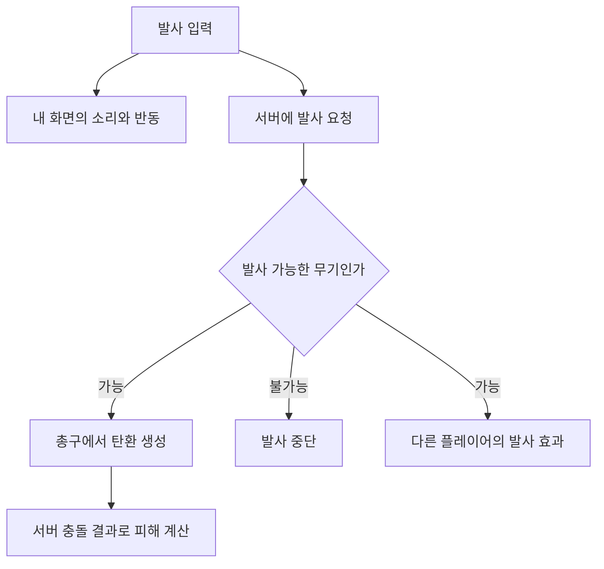

# 멀티플레이 배틀로얄 - Unreal Engine C++ 포트폴리오

> 언리얼 엔진과 C++로 만든 멀티플레이 배틀로얄 프로젝트입니다.  
> 방 생성과 참가부터 아이템 획득, 전투, 팀원 소생, 자기장까지 이어지는 흐름을 구현했습니다.  
> 멀티플레이에서 값을 바꾸는 처리와 각 플레이어의 화면에 보여주는 처리를 나누는 데 신경 썼습니다.

---

## 영상

플레이 영상 추가 예정입니다.

<!-- 실제 플레이 영상을 올린 뒤 이 문장을 영상 링크로 교체합니다.
추천 장면: 두 플레이어의 로비 접속 → 아이템 획득과 장착 → 사격과 피해 → 팀원 소생 → 자기장과 지도 → 차량 탑승·하차
스크린샷이나 GIF는 아래 각 기능의 주석 위치에 추가할 수 있습니다.
-->

---

<a id="table-of-contents"></a>

## 목차

- [1. 프로젝트 개요](#overview)
- [2. 핵심 기술 요약](#tech-summary)
- [3. 시스템 구조](#system-architecture)
- [4. 핵심 기술 상세](#core-tech)
  - [4.1 서버 처리와 화면 처리 나누기](#network)
  - [4.2 로비와 경기 진행](#match-flow)
  - [4.3 인벤토리와 아이템 관리](#inventory)
  - [4.4 사격, 재장전, 피해 처리](#combat)
  - [4.5 장비, 애니메이션, 캐릭터 미리보기](#character)
  - [4.6 다운, 소생, 사망 처리](#team-play)
  - [4.7 자기장](#zone)
  - [4.8 미니맵과 전체 지도](#minimap)
  - [4.9 차량 탑승과 하차](#vehicle)
  - [4.10 AI 대상 탐색과 이동 위치 선정](#ai)
- [5. 코드 구조](#code-structure)
- [6. 설계에서 선택한 점과 개선할 부분](#tradeoffs)
- [7. 한 줄 요약](#one-line-summary)

---

<a id="overview"></a>

## 1. 프로젝트 개요

| 항목 | 내용 |
| --- | --- |
| 프로젝트 | 멀티플레이 배틀로얄 / 코드 모듈명 PP4 |
| 장르 | 슈팅, 배틀로얄 |
| 엔진 / 언어 | Unreal Engine / C++ |
| 멀티플레이 방식 | 방을 만든 플레이어가 서버 역할도 함께 맡는 방식 |
| 경기 설정 | 솔로, 듀오, 스쿼드 구분 / 데스매치 옵션 |
| 주요 구현 범위 | 로비, 경기 진행, 캐릭터, 인벤토리, 전투, 팀 플레이, 자기장, 지도, 차량 탑승·하차 |
| 구현 목표 | 여러 플레이어가 함께하는 경기에서 각 기능이 어떻게 연결되는지 구현하기 |

<!-- 개발 기간, 참여 인원, 본인 담당 범위, 정확한 엔진 버전은 확인 후 추가합니다. -->

보유 아이템 목록은 해당 플레이어의 화면에 표시하고, 장착한 무기와 방어구의 모습은 다른 플레이어에게도 보여줘야 했습니다. 총을 쏠 때도 내 화면의 반응과 실제 피해 계산을 함께 생각해야 했습니다.

이런 차이를 기준으로 서버에서 처리할 일, 내 화면에서 처리할 일, 다른 플레이어에게 전달할 일을 나눴습니다. 각 기능을 로비 접속부터 경기 종료까지 이어지는 흐름 안에 연결했습니다.

<a id="tech-summary"></a>

## 2. 핵심 기술 요약

| 핵심 내용 | 구현한 방식 |
| --- | --- |
| 멀티플레이 처리 구분 | 서버 요청, 내 화면 갱신, 다른 플레이어에게 보여줄 상태를 구분 |
| 로비와 경기 진행 | 방 생성·검색·참가의 완료 결과 처리, 인원 조건과 시작 대기 시간 관리 |
| 인벤토리 | 아이템 종류, 서버에서 찾는 고유 번호, 화면의 칸 번호를 따로 관리 |
| 사격과 피해 | 조준점으로 방향을 구하고 총구에서 탄환 생성, 서버의 충돌 결과로 피해 계산 |
| 장비와 애니메이션 | 장비 부착 위치, 재장전 시점, 캐릭터 외형 변경 연결 |
| 팀 플레이 | 다운 상태, 소생 진행과 취소, 사망 후 결과 화면과 관전 요청 연결 |
| 자기장과 지도 | 단계별 자기장 설정, 현재·다음 구역 표시, 게임 속 위치를 지도 좌표로 변환 |
| 차량 | 빈 좌석 선택, 운전석 조작 대상 전환, 하차 위치 확인과 캐릭터 이동 복구 |

<a id="system-architecture"></a>

## 3. 시스템 구조

경기 전체의 규칙은 GameMode에서 처리하고, 플레이어들이 함께 알아야 할 경기 상태는 GameState에서 관리했습니다. PlayerController는 내 화면과 입력을 연결하고, Character는 실제 캐릭터 행동을 처리하도록 구성했습니다.

| 코드 | 맡은 일 |
| --- | --- |
| BRGameInstance | 방 생성·검색·참가, 선택한 캐릭터와 경기 설정 보관, 맵 이동 |
| BRGameMode / PlaneGameMode | 시작 조건, 캐릭터 생성, 팀과 승리 조건, 비행기에서 시작하는 경기 |
| BRGameState | 경기·참가자 상태 공유, 강하 가능 여부 전달, 서버의 팀 목록 관리 |
| BRPlayerController | 입력, 화면 생성, 강하 요청, 팀원 연결, 관전 대상 전환 |
| BRCharacter | 이동, 아이템 상호작용, 장비, 사격 요청, 체력, 소생, 차량 탑승 |
| PickupItem / WeaponItem / Bullet | 바닥 아이템 상태, 무기별 설정과 발사, 탄환 충돌과 피해 |
| Zone / MinimapComponent | 자기장 진행, 지도 위치 계산과 표시 |
| Widget 폴더 | 로비, 인벤토리, 체력·탄약 표시, 지도, 결과 화면 |

사격을 예로 들면 아래처럼 나눴습니다.



<a id="core-tech"></a>

## 4. 핵심 기술 상세

<a id="network"></a>

### 4.1 서버 처리와 화면 처리 나누기

멀티플레이에서는 같은 행동이라도 누가 처리해야 하는지가 달라집니다. 아이템 획득 결과는 서버에서 정리하고, 인벤토리 화면은 그 아이템을 가진 플레이어에게 갱신해 줘야 했습니다.

그래서 서버에 작업을 요청하는 함수와, 내 화면을 갱신하는 함수, 다른 플레이어에게도 행동을 보여주는 함수를 나눴습니다.

#### 내 정보와 다른 플레이어에게 필요한 정보를 구분했습니다

| 정보 | 전달 방식 |
| --- | --- |
| 보유 탄약 합계 | 해당 캐릭터를 조작하는 플레이어에게만 전달 |
| 인벤토리 아이템 추가·수량 변경 | 서버 목록을 바꾼 뒤 해당 플레이어의 화면 갱신 |
| 조준, 걷기 상태, 기울이기 | 내 입력으로 처리한 상태를 다른 플레이어에게 전달 |
| 의상과 방어구 외형 | 바뀐 정보를 전달하고, 받은 쪽에서 외형 갱신 |
| 다운 상태, 소생 중 여부 | 상태를 전달하고 관련 화면과 동작 갱신 |

예를 들어 보유 탄약 합계는 다른 사람의 화면에 표시할 필요가 없어 소유자에게만 전달했습니다. 조준 상태는 내가 입력했을 때 먼저 바꾸고, 그 결과를 다른 플레이어에게 전달했습니다.

#### 이미 재생한 동작은 중복으로 보여주지 않도록 했습니다

무기 소리와 동작을 내 화면에서 먼저 재생한 뒤, 다른 플레이어에게도 재생 요청을 보냅니다. 이때 내 캐릭터를 직접 조작하는 화면에서는 같은 동작을 다시 재생하지 않도록 조건을 넣었습니다.

이 구분을 사격 효과와 캐릭터 동작 재생에 사용했습니다. 탄약 수량의 확정 처리는 별도로 다듬을 부분이 있어 개선 항목에 정리했습니다.

<details>
<summary>코드 파일 / 함수 목록 보기</summary>

- PP4/Character/BRCharacter.cpp: GetLifetimeReplicatedProps, MCPlayMontage_Implementation, CLIENTAddNewInventoryItem_Implementation
- PP4/Items/WeaponItem.cpp: MCPlaySoundandEffect_Implementation
- PP4/Character/BRCharacter.h: 서버 요청 함수, 화면 갱신 함수, 상태 전달 설정

핵심 설정을 발췌했습니다.

```cpp
DOREPLIFETIME_CONDITION(ABRCharacter, TotalAmmo, COND_OwnerOnly);
DOREPLIFETIME_CONDITION(ABRCharacter, Aiming, COND_SkipOwner);
DOREPLIFETIME(ABRCharacter, IsPlayerDown);
```

각각 보유 탄약은 소유자에게만, 조준 상태는 소유자를 제외한 플레이어에게, 다운 상태는 함께 전달하는 설정입니다.

</details>

[목차로](#table-of-contents)

<a id="match-flow"></a>

### 4.2 로비와 경기 진행

#### 방 만들기와 참가하기를 완료 결과에 맞춰 연결했습니다

방 생성이나 검색은 요청한 순간 끝나는 작업이 아닙니다. 요청 후 결과를 받았을 때 다음 화면이나 맵으로 넘어가도록 구성했습니다.

방을 만들 때는 방 이름, 참가 인원, 경기 방식, 맵 등의 설정을 전달합니다. 기존 방이 있으면 방을 없애는 작업이 끝난 뒤 새 방 생성을 요청하도록 연결했습니다.

방 검색 화면에서는 검색 중 표시와 버튼 상태를 바꾸고, 결과를 받으면 방 이름과 연결 지연 시간을 목록에 보여줍니다. 참가가 성공하면 전달받은 접속 주소로 이동합니다. 주소를 직접 입력해서 참가하는 흐름도 따로 두었습니다.

#### 대기부터 종료까지 경기 상태를 구분했습니다

| 상태 | 처리 내용 |
| --- | --- |
| 대기 | 참가자를 등록하고 경기 시작 조건 확인 |
| 시작 준비 | 시작까지 남은 시간 표시 |
| 진행 | 캐릭터 배치, 전투와 자기장 진행 |
| 종료 | 승리 조건에 따른 결과 전달과 결과 화면 표시 |

설정한 인원 조건과 대기 시간을 기준으로 시작 여부를 판단합니다. 시작 준비 중 인원이 부족해지면 다시 대기 상태로 돌아가는 처리도 두었습니다.

팀원 정보가 먼저 도착하고 캐릭터가 아직 생성되지 않은 경우에는 바로 연결할 수 없습니다. 연결하지 못한 팀원은 목록에 남겨 두고, 타이머에서 다시 확인하도록 했습니다.

#### 비행기 강하와 보급을 경기 흐름에 연결했습니다

비행기에서 시작하는 경기에서는 캐릭터를 숨기고 조작을 잠시 해제합니다. 강하 요청이 허용되면 서버에서 캐릭터를 비행기의 강하 위치로 옮긴 뒤 다시 조작할 수 있게 합니다.

강하 중에는 지면까지의 거리를 확인하는 처리와 낙하산을 여는 처리를 두었습니다. 착지하면 낙하산과 이동 상태를 정리하도록 연결했습니다.

보급은 별도 코드에서 생성 간격과 개수를 관리합니다. 보급 비행기, 보급 상자, 상자에서 생성할 아이템 설정을 나눴습니다.

<!-- 로비 접속 → 경기 시작 → 비행기 강하 장면 -->

<details>
<summary>코드 파일 / 함수 목록 보기</summary>

- PP4/Main/BRGameInstance.cpp: HostGame, OnCreateSessionComplete, OnDestroySessionComplete, FindSession, OnFindSessionsComplete, OnJoinSessionComplete, LoadGame
- PP4/Main/BRGameMode.cpp: GetSettings, CheckIfGameTime, StartGameSetTimer, StartGame, PlayerDied, GameEnded
- PP4/Main/BRGameState.cpp: AddNewPlayer, SetGameStatus
- PP4/Main/BRPlayerController.cpp: CheckAdded, RequestJumpOffPlane_Implementation
- PP4/Main/PlaneGameMode.cpp: BRPlaneStartGame, RequestJumpOff
- PP4/Map/AirPlane.cpp / PlaneDropGameModeComp.cpp / PlaneAirDrop.cpp / AirDropBox.cpp
- PP4/Character/BRCharacter.cpp: OffPlaneTraceGround, mcOpenParachute, Landed
- PP4/Widget/Lobby/LobbyScreen.cpp / SessionsList.cpp / SessionEntry.cpp

</details>

[목차로](#table-of-contents)

<a id="inventory"></a>

### 4.3 인벤토리와 아이템 관리

#### 화면의 칸 번호와 실제 아이템 번호를 나눴습니다

인벤토리에서는 아이템을 드래그해서 칸을 바꿀 수 있습니다. 이때 화면의 몇 번째 칸에 있는지만으로 서버의 아이템을 찾으면, 화면 배치가 바뀔 때 서로 다른 아이템을 가리킬 수 있습니다.

그래서 아이템 종류, 서버에서 아이템을 찾는 번호, 화면의 칸 번호를 따로 관리했습니다.

| 구분 | 쓰는 곳 |
| --- | --- |
| 아이템 종류 ID | 아이템 데이터에서 이름, 이미지, 무게, 장착 가능 위치 등을 찾을 때 |
| 서버 고유 번호 | 해당 캐릭터의 인벤토리 목록에서 사용할 아이템을 찾을 때 |
| 화면 칸 번호 | 아이템을 어느 칸에 보여줄지 정할 때 |

같은 인벤토리 안에서 칸을 옮길 때는 아이템 정보와 고유 번호를 함께 옮깁니다. 사용이나 버리기를 요청할 때는 그 고유 번호를 전달해 서버 목록에서 아이템을 찾도록 했습니다.

#### 획득할 때 장착, 교체, 보관을 나눠 처리했습니다

아이템을 줍는 요청이 들어오면 서버에서 아이템이 아직 바닥에 있는 상태인지 확인합니다. 이어서 장착 가능한 빈 자리가 있는지, 기존 장비를 교체할 수 있는지 확인합니다.

인벤토리에 보관하는 경우에는 아이템 개수와 무게로 담을 수 있는지 계산합니다. 같은 종류의 아이템을 쌓을 수 있으면 기존 수량을 늘리고, 새 항목이면 고유 번호를 만들어 목록에 추가합니다.

처리가 끝나면 획득한 플레이어의 화면에 추가되거나 바뀐 수량을 전달합니다. 바닥 아이템은 설정에 따라 숨기거나 제거하거나, 인벤토리 상태로 바꿉니다.

#### 아이템 정보는 공통 데이터에서 가져오도록 했습니다

아이템 이름, 설명, 이미지, 개수, 무게, 장착 가능한 위치를 공통 데이터로 관리했습니다. 아이템을 획득할 때와 화면에 표시할 때 이 정보를 사용합니다.

일반 인벤토리, 무기 칸, 방어구 칸은 같은 칸 위젯을 사용하고, 각 칸이 받을 수 있는 아이템과 표시 설정을 다르게 주었습니다. 수량을 입력해서 버리는 화면과 소모품 사용 진행 화면도 연결했습니다.

소모품은 사용 진행 표시가 끝나면 아이템 번호로 서버에 사용을 요청합니다. 아이템 종류에 따라 체력, 수분, 부스트 값을 바꾸고 사용한 수량을 줄이는 처리로 연결했습니다.

현재 버리기 처리에는 버릴 개수와 남은 개수를 잘못 사용하는 부분이 있어 수정이 필요합니다.

<!-- 같은 아이템 추가 획득, 인벤토리 칸 이동, 장비 장착 장면 -->

<details>
<summary>코드 파일 / 함수 목록 보기</summary>

- PP4/GameInfo.h: FPickupInfos, FServerInventory, ESlotType
- PP4/Etc/InventorySystem/PickupComponent.cpp: BeginPlay
- PP4/Character/BRCharacter.cpp: ServerAttemptPickupItem, ClientInventoryDragDrop, CanAddedInventory, InventoryDropItemRequest
- PP4/Widget/Inventory/ItemWidget.cpp: NativeOnDrop, SwitchInfo, UpdateInfo
- PP4/Widget/Inventory/ItemsContainer.cpp: UpdateCountID, GetIDItemWidget
- PP4/Widget/Inventory/InventoryBackground.cpp / ConsumeWidget.cpp

서버에 새 아이템을 추가할 때 사용하는 정보 중 일부입니다.

```cpp
FServerInventory Item;
Item.ID = Info.ID;
Item.ServerUniqueID = GetNewUniqueID();
Item.Count = Info.Count;
Item.Weight = Info.Weight;
```

아이템 종류와 인벤토리 안에서 찾을 번호를 따로 저장했습니다. 이 고유 번호는 각 캐릭터의 인벤토리 안에서 사용합니다.

</details>

[목차로](#table-of-contents)

<a id="combat"></a>

### 4.4 사격, 재장전, 피해 처리

#### 조준하는 곳과 탄환이 나가는 곳을 구분했습니다

화면 중앙에서 조준한 위치와 캐릭터가 들고 있는 총구 위치는 다릅니다. 특히 3인칭에서는 카메라가 캐릭터 뒤에 있어 두 위치의 차이를 함께 처리해야 합니다.

조준 방향으로 충돌 검사를 해서 목표 위치를 구한 뒤, 총구에서 그 위치를 향하도록 탄환의 방향을 정했습니다. 실제 탄환은 서버에서 생성합니다.

탄환은 이동하면서 충돌을 확인하고, 맞은 결과에 따라 피해를 계산합니다. 조준 위치를 찾는 검사와 실제 탄환의 충돌 처리를 나눴습니다.

#### 발사 반응은 내 화면에서 먼저 보여주도록 했습니다

발사 입력에서는 무기 소리와 효과, 화면 반동을 처리합니다. 서버에는 발사를 요청하고, 서버 쪽 무기는 발사 가능 상태를 확인한 뒤 탄환을 생성합니다.

연사 무기는 설정된 발사 간격으로 반복 실행합니다. 발사를 놓거나 탄약이 떨어지면 반복 처리와 발사 효과를 정리합니다.

#### 맞은 부위와 방어구를 피해 계산에 반영했습니다

머리에 맞았을 때는 기본 피해에 배수를 적용합니다. 머리 방어구와 몸 방어구를 구분하고, 방어구가 받아낼 수 있는 피해를 먼저 계산한 뒤 남은 피해를 체력에 적용합니다.

이후 캐릭터의 피해 처리에서 경기 진행 상태, 생존 상태, 같은 팀 공격 허용 여부 등을 확인하도록 구성했습니다. 명중 표시와 처치 정보는 관련 플레이어의 화면으로 전달합니다.

#### 재장전은 동작의 지정된 시점에 맞췄습니다

재장전 입력에서는 동작을 재생하고, 애니메이션의 지정된 시점에 서버로 재장전을 요청합니다.

서버에서는 탄창을 채우는 데 필요한 수와 보유 탄약을 비교합니다. 사용한 탄약만큼 인벤토리 수량과 무게를 갱신하고, 탄창 수량과 화면 표시를 연결했습니다.

수류탄도 던지는 동작의 지정된 시점에 생성을 요청하도록 했습니다. 생성된 폭발물은 타이머가 끝났을 때 주변 충돌 범위를 확인해 피해를 주는 구조입니다.

<!-- 두 플레이어 화면에서 사격, 방어구 피해, 재장전 장면 -->

<details>
<summary>코드 파일 / 함수 목록 보기</summary>

- PP4/Character/BRCharacter.cpp: PressAttack, WeaponFire, ServerFireWeapon, TraceToCrosshair, ServerReloadWeapon, DamageTaken
- PP4/Items/WeaponItem.cpp: StartFire, Fire, Reload, StopFire
- PP4/Items/Bullet.cpp: OnHit, GetDamageMultiplier, CalculateArmorDamage
- PP4/Character/Animation/BRAnim.cpp: AnimNotify_RifleReload, AnimNotify_PistolReload, AnimNotify_ThrowGrenade
- PP4/Items/Explosives.cpp / Bullet/GrenadeBullet.cpp

</details>

[목차로](#table-of-contents)

<a id="character"></a>

### 4.5 장비, 애니메이션, 캐릭터 미리보기

#### 장비를 바꿀 때 손, 등, 화면을 함께 갱신했습니다

장비를 바꾸면 인벤토리의 아이콘뿐 아니라 캐릭터가 들고 있는 무기와 등에 붙어 있는 무기도 바뀌어야 합니다.

아이템 데이터에 손에 들었을 때와 보관했을 때의 부착 위치를 두고, 현재 선택한 장비 칸에 맞춰 무기를 옮기도록 했습니다. 무기를 꺼내는 동작에서 실제 장비를 바꾸는 시점도 따로 연결했습니다.

의상과 방어구는 외형 정보를 전달하고, 값이 바뀌었다는 알림을 받으면 해당 부위의 외형을 갱신합니다. 캐릭터 동작을 따라 움직여야 하는 장비는 몸의 애니메이션을 함께 따르도록 설정했습니다.

#### 이동과 카메라 상태를 애니메이션에 연결했습니다

걷기, 달리기, 앉기, 좌우 기울이기와 조준 상태를 나눴습니다. 애니메이션에서는 이동 속도와 방향, 조준 방향, 현재 장비 상태를 읽어 동작에 사용할 값을 갱신합니다.

카메라는 조준 중 1인칭과 3인칭을 전환하는 흐름을 두었습니다. 조준 시 화면에 보이는 범위를 바꾸고, 무기 설정에 따라 스코프 화면을 사용하는 처리도 연결했습니다.

#### 인벤토리 안에는 별도의 미리보기 캐릭터를 사용했습니다

인벤토리에서 장착 상태를 확인할 수 있도록 미리보기용 캐릭터와 촬영용 카메라를 따로 두었습니다. 무기, 방어구, 가방 변경을 미리보기에도 반영하고, 마우스로 캐릭터를 돌려 볼 수 있도록 했습니다.

인벤토리 화면을 열 때 촬영을 켜고 닫을 때 끄도록 연결했습니다. 실제 플레이 캐릭터를 돌리지 않고도 장착한 모습을 확인할 수 있는 구조입니다.

<!-- 장착 위치 변경, 조준 시점 전환, 인벤토리 캐릭터 회전 장면 -->

<details>
<summary>코드 파일 / 함수 목록 보기</summary>

- PP4/Character/BRCharacter.cpp: EquipSocket, ActiveSlotChanged, HandleClothInfoChanged, OnEquipUpdatePreviewCharacter, ChangeCamera, SetEnableScope
- PP4/Character/Animation/BRAnim.cpp: NativeUpdateAnimation, AnimNotify_EquipWeapon
- PP4/Etc/InventorySystem/CharacterPreview.cpp: WeaponEquip, UpdateClothSlot, BackpackEquip, RotationCharacter, TogglePreview
- PP4/Widget/Inventory/InventoryWidget.cpp: NativeConstruct, NativeDestruct, NativeOnMouseMove

</details>

[목차로](#table-of-contents)

<a id="team-play"></a>

### 4.6 다운, 소생, 사망 처리

팀 경기에서는 체력이 0이 된 뒤에도 팀원의 도움을 기다리는 상태가 필요합니다. 그래서 다운 상태와 사망 상태를 나누고, 다운된 동안 체력이 줄어드는 처리를 두었습니다.

팀원이 소생을 시작하면 진행 표시를 보여주고, 도움을 받는 캐릭터에게도 소생 중이라는 상태를 전달합니다. 소생 중에는 다운 상태의 체력 감소를 잠시 멈춥니다.

상호작용을 놓으면 진행 표시와 소생 중 상태를 해제합니다. 진행 표시가 끝나면 서버에 완료를 요청하고 다운 상태를 해제하도록 연결했습니다. 소생 시간과 거리를 서버에서 다시 확인하는 부분은 추가로 보완해야 합니다.

사망할 때는 장착한 무기와 코드에 지정된 보유 아이템을 바닥에 떨어뜨리고, 처치 정보와 경기 결과를 연결합니다. 결과 화면에서는 팀원이나 다른 플레이어의 화면으로 관전 대상을 바꾸는 요청을 할 수 있습니다.

데스매치는 사망 후 대기 시간을 거쳐 캐릭터를 다시 생성하는 흐름으로 나눴습니다.

<!-- 다운 → 소생 시작 → 취소 → 소생 완료 장면 -->

<details>
<summary>코드 파일 / 함수 목록 보기</summary>

- PP4/Character/BRCharacter.cpp: DamageTaken, OnServerPlayerDown, PlayerDownHealthDepleted, ReleaseInteract, OnReviveProgressDone, ServerOnReviveDone, SERVERDropEquipItemsOnDeath
- PP4/Widget/InGameWidget.cpp: StartRevive, StopRevive, ReviveProgressAnimFinished
- PP4/Main/BRGameMode.cpp: PlayerDied, HandleSoloWinCondition, HandleTeamWinCondition, SpawnOnDeathMatch
- PP4/Main/BRPlayerController.cpp: SpectateTeam, SpectateRandom
- PP4/Widget/OnGameEndedWidget.cpp / OnDeathMatchDeath.cpp / TeammateHealth.cpp

</details>

[목차로](#table-of-contents)

<a id="zone"></a>

### 4.7 자기장

#### 단계별 설정과 실제 움직임을 나눴습니다

자기장은 줄어드는 크기뿐 아니라 이동 속도, 대기 시간, 바깥에서 받는 피해가 함께 바뀌어야 합니다.

단계마다 이동 속도, 초당 피해, 대기 시간을 설정할 수 있게 했습니다. 다음 목표 위치와 크기를 정하고, 대기와 이동을 반복하며 마지막 크기까지 줄어드는 흐름으로 구성했습니다.

서버에서는 다음 목표 위치와 크기, 이동 속도를 전달합니다. 전달받은 쪽에서는 그 값을 사용해 위치와 크기를 조금씩 바꾸도록 했습니다.

#### 구역 안팎의 상태를 피해와 화면에 연결했습니다

1초마다 자기장 안에 겹쳐 있는 캐릭터 목록을 확인합니다. 이전 목록과 비교해 안으로 들어온 캐릭터와 밖으로 나간 캐릭터를 구분합니다.

밖에 있는 것으로 관리 중인 캐릭터에게는 현재 단계의 피해를 적용합니다. 플레이어의 화면 효과와 AI의 구역 안팎 상태도 이 흐름에서 갱신합니다.

현재 구역과 다음 목표 구역은 지도에 다른 색의 원으로 표시하고, 화면에는 자기장 이동까지 남은 시간과 이동 중 상태를 보여줍니다.

<!-- 자기장 대기 → 축소, 지도에서 현재·다음 구역 표시 장면 -->

<details>
<summary>코드 파일 / 함수 목록 보기</summary>

- PP4/GameInfo.h: FZoneStep
- PP4/World/Zone.cpp: StartZone, SetupStep, GetNextPoint, HandlePlayersInside, DamageTimer, MCDoShrink_Implementation
- PP4/Widget/Minimap/MinimapComponent.cpp: NativePaint, MDrawCircle
- PP4/Widget/InGameWidget.cpp: ZoneStarting, ZoneMoving, ZonePaused

</details>

[목차로](#table-of-contents)

<a id="minimap"></a>

### 4.8 미니맵과 전체 지도

#### 같은 지도 코드를 두 화면에서 사용했습니다

미니맵은 플레이어 주변을 보여주고, 전체 지도는 맵 전체에서 위치를 확인하는 데 사용합니다. 두 화면에서 위치 계산을 따로 만들지 않도록 공통 지도 위젯을 사용하고 표시 방식을 구분했습니다.

미니맵에서는 플레이어 위치를 기준으로 다른 대상까지의 거리를 계산합니다. 전체 지도에서는 맵 중심을 기준으로 계산합니다. 여기에 지도 크기와 확대 값을 적용해 아이콘이 놓일 화면 위치를 구합니다.

캐릭터가 바라보는 방향과 카메라가 바라보는 방향도 나눠 표시했습니다. 지도 회전 설정에 따라 지도와 아이콘의 회전을 갱신합니다.

#### 클릭한 지도 위치를 게임 속 위치로 바꿨습니다

아이콘 표시는 게임 속 위치를 지도 위치로 바꾸는 과정입니다. 반대로 지도를 클릭했을 때는 마우스 위치를 지도 안의 좌표로 바꾼 뒤, 게임 속 위치로 계산했습니다.

계산한 위치에 왼쪽 클릭으로 표시를 만들거나 옮기고, 오른쪽 클릭으로 지웁니다. 팀 경기에서는 서버에도 위치를 전달해 같은 팀의 지도에 표시를 추가하는 흐름을 두었습니다.

전체 지도는 마우스 휠로 확대·축소하고, 확대한 상태에서는 드래그해서 볼 위치를 옮길 수 있게 했습니다. 표시 대상이 사라지면 연결된 지도 아이콘도 정리합니다.

<!-- 전체 지도 확대·이동, 위치 표시 생성·삭제, 팀원 지도 표시 장면 -->

<details>
<summary>코드 파일 / 함수 목록 보기</summary>

- PP4/Widget/Minimap/MinimapComponent.cpp: UpdatePOIs, MinimapStartUpdate, OnMinimapClick, NativeOnMouseWheel, NativeOnMouseMove
- PP4/Widget/Minimap/POIW.cpp: SetRotation, HandleHeightIndic
- PP4/Widget/Minimap/MinimapWidget.h / OverviewMap.cpp
- PP4/Character/BRCharacter.cpp: OverviewMapClicked, SERVERAddUpdateMarker_Implementation, SERVERRemoveMarker_Implementation
- PP4/Etc/MiniMapActors/BigMapMarker.cpp / Parent_PointOfInterest.cpp

</details>

[목차로](#table-of-contents)

<a id="vehicle"></a>

### 4.9 차량 탑승과 하차

차량에 탑승할 때는 캐릭터 위치뿐 아니라 조작 대상과 이동 상태도 함께 바뀝니다. 운전석과 동승석의 처리도 달라야 했습니다.

서버에서 빈 좌석을 찾고, 선택한 좌석에 캐릭터를 붙입니다. 탑승 중에는 캐릭터의 일반 이동과 중력 처리를 바꾸고, 운전석에 탄 경우에는 조작 대상을 차량으로 넘깁니다. 좌석이 비어 있는지에 대한 상태는 함께 전달합니다.

하차할 때는 좌석 옆, 차량 뒤, 차량 앞을 순서대로 검사해 위치를 찾습니다. 후보 위치에 장애물이 있으면 다음 위치를 확인하고, 캐릭터를 옮긴 뒤 다시 캐릭터를 조작하도록 합니다. 탑승 중 바꾼 이동과 충돌 관련 설정도 복구합니다.

차량에는 속도와 기어 표시, 차 안 카메라, 충돌 시 피해를 주는 코드도 두었습니다.

별도로 작성된 차량 이동 보정 코드는 현재 실행이 중단된 상태입니다. 이 항목에서는 좌석 관리와 탑승·하차 흐름을 다룹니다.

<!-- 운전석·동승석 탑승, 벽 옆에서 하차 위치 선택 장면 -->

<details>
<summary>코드 파일 / 함수 목록 보기</summary>

- PP4/Character/BRCharacter.cpp: ServerHandleRequestEnterVehicle, ServerHandleExitingVehicle, SetInVehicle, MCPlayerExitedVehicle_Implementation
- PP4/Vehicles/Vehicle.cpp: GetEmptySeat, SetSeatOwner, FindEmptySpot, NotifyHit, UpdateHUDStrings
- PP4/Main/BRPlayerController.cpp: CLIENTInVehicleUpdate_Implementation
- PP4/Vehicles/VehicleMovementComponent.cpp / VehicleHUD.cpp

</details>

[목차로](#table-of-contents)

<a id="ai"></a>

### 4.10 AI 대상 탐색과 이동 위치 선정

AI는 주변 대상을 찾는 처리와 이동할 위치를 고르는 처리를 나눴습니다.

대상 탐색에서는 플레이어와 AI 목록을 확인하고, 거리와 시야 방향, 중간 충돌 결과를 사용해 목표를 고릅니다. 찾은 목표와 발견 여부를 AI가 행동을 고를 때 사용하는 공통 정보에 저장합니다.

이동 위치는 캐릭터가 이동 가능한 영역에서 구하도록 했습니다. 자기장 바깥 상태에서는 대상 탐색을 건너뛰고 이동 속도와 관련 상태를 바꾸는 흐름을 두었습니다.

공격 처리도 별도 파일로 나눠져 있지만, 현재 공격 작업은 함수 앞에서 종료되므로 이 항목은 대상 탐색과 이동 위치 선정 코드까지의 범위입니다.

<details>
<summary>코드 파일 / 함수 목록 보기</summary>

- PP4/Character/AI/BRAIController.cpp
- PP4/Character/AI/AICharacter.cpp
- PP4/Character/AI/Tasks/Detect.cpp
- PP4/Character/AI/Tasks/RandomLocation.cpp / RandomLocationInZone.cpp
- PP4/Character/AI/Tasks/EngageTarget.cpp: 현재 공격 경로가 중단된 부분

</details>

[목차로](#table-of-contents)

<a id="code-structure"></a>

## 5. 코드 구조

PP4 모듈을 기준으로 정리했습니다.

| 경로 | 내용 |
| --- | --- |
| PP4/Main | 게임 설정, 방 연결, 경기 규칙, 플레이어와 경기 상태 |
| PP4/Main/Lobby | 로비 참가자와 캐릭터 선택 연결 |
| PP4/Character | 플레이어의 이동, 전투, 아이템, 체력, 팀 플레이 |
| PP4/Character/Animation | 캐릭터 상태를 애니메이션에 전달, 동작 시점과 기능 연결 |
| PP4/Character/AI | AI 제어, 대상 탐색, 이동 위치 선택 |
| PP4/Items | 아이템 공통 상태, 무기, 탄환, 방어구, 소모품, 폭발물 |
| PP4/Etc/InventorySystem | 아이템 데이터 연결, 장착 상태 미리보기 |
| PP4/Etc/MiniMapActors | 지도에 표시할 대상과 위치 표시 |
| PP4/Map | 강하 비행기, 보급 비행기, 보급 상자, 맵 시작 처리 |
| PP4/World | 자기장 |
| PP4/Vehicles | 차량 좌석, 입력, 화면, 이동 관련 코드 |
| PP4/Widget | 로비, 인벤토리, 지도, 경기 정보와 결과 화면 |
| PP4/GameInfo.h | 아이템, 장비 칸, 팀, 경기와 자기장 설정에 쓰는 공통 데이터 |
| PP4/PP4.Build.cs | 프로젝트에서 사용하는 엔진 모듈 설정 |

<a id="tradeoffs"></a>

## 6. 설계에서 선택한 점과 개선할 부분

### 설계에서 선택한 점

**화면의 빠른 반응과 서버의 게임 처리를 나눴습니다.**  
발사 소리와 반동은 입력한 화면에서 처리하고, 발사 요청은 서버에 전달했습니다. 각 화면에서 먼저 처리한 동작이 다시 재생되지 않도록 조건을 두었습니다.

**인벤토리 배치와 아이템 관리를 분리했습니다.**  
화면 안에서 칸을 옮겨도 아이템을 찾을 수 있도록 별도 번호를 사용했습니다. 대신 UI와 서버 목록 사이에서 번호, 수량, 장비 상태를 정확히 맞춰 주는 처리가 필요합니다.

**매 순간 필요한 처리와 간격을 두어도 되는 처리를 나눴습니다.**  
카메라와 지도 위치는 프레임마다 갱신하고, 자기장 피해와 체력 감소, 참가 상태 확인 등은 타이머로 처리했습니다. 각 기능에 맞는 갱신 시점을 두는 방식으로 구성했습니다.

### 개선할 부분

- **인벤토리 수량 처리:** 버리기에서 버릴 개수와 남은 개수를 구분하고, 서버와 화면에서 아이템을 합치는 기준을 맞출 필요가 있습니다.
- **탄약과 소생 요청 확인:** 탄약 값을 바꾸는 요청과 소생 완료 요청을 서버에서 더 엄격하게 확인해야 합니다.
- **경기 중 예외 처리:** 세션을 나갔다 다시 만드는 흐름, 마지막 생존자가 AI인 경우, 다운 대상의 팀 판정을 보완해야 합니다.
- **현재 중단된 기능:** 차량 이동 보정과 AI 공격은 실행 경로를 정리한 뒤 여러 플레이어 환경에서 확인해야 합니다.
- **캐릭터 코드 분리:** Character에 인벤토리, 전투, 팀 플레이, 차량 연결이 많이 모여 있어 기능별로 나누면 수정할 범위를 줄일 수 있습니다.

이 문서는 C++ 구현을 기준으로 정리했습니다. 실제 실행에는 맵, 블루프린트, 아이템 데이터, 애니메이션과 프로젝트 설정이 함께 필요합니다. 접속 인원별 동작과 성능 수치는 실행 확인 후 추가할 예정입니다.

<a id="one-line-summary"></a>

## 7. 한 줄 요약

여러 플레이어가 함께하는 배틀로얄에서 서버의 게임 처리와 각 플레이어의 화면을 나누고, 로비부터 아이템·전투·팀 플레이·자기장까지 연결한 프로젝트입니다.

[목차로](#table-of-contents)
