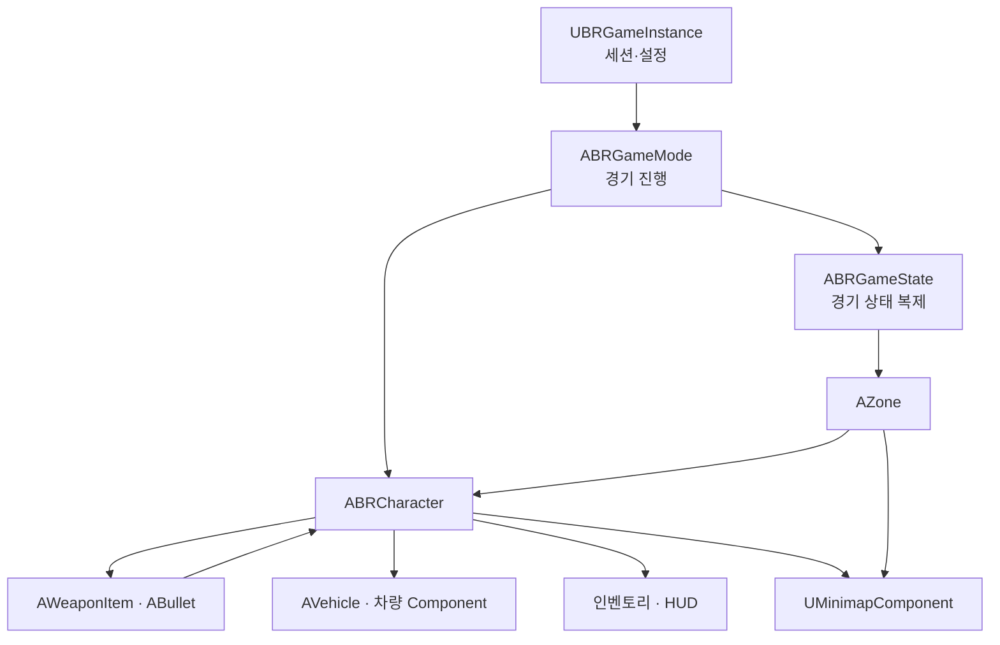

# Battle Royale - Unreal Engine C++ 클라이언트 포트폴리오

> Unreal Engine C++ 기반 멀티플레이 배틀로얄 프로젝트입니다.  
> **서버에서 처리하는 전투·인벤토리와 팀원 소생**, **차량 입력 동기화와 원격 보간**, **단계별 자기장과 지도 표시**를 구현했습니다. 발사·아이템 수량·소생 결과는 서버에서 처리하고, 소유자의 UI와 다른 플레이어에게 보이는 상태를 나눠 갱신했습니다.

---

<a id="table-of-contents"></a>

## 목차

- [1. 프로젝트 개요](#overview)
- [2. 핵심 기술 요약](#tech-summary)
- [3. 시스템 구조](#system-architecture)
- [4. 핵심 기술 상세](#core-tech)
  - [4.1 전투 처리와 상태 복제](#combat-replication)
  - [4.2 차량 입력 동기화와 원격 보간](#vehicle-replication)
  - [4.3 서버 인벤토리와 장비·UI 연동](#inventory-equipment)
  - [4.4 단계별 자기장과 지도 좌표 변환](#zone-minimap)
- [5. 코드 구조](#code-structure)
- [6. 설계상 트레이드오프](#tradeoffs)

---

<a id="overview"></a>

## 1. 프로젝트 개요

| 항목 | 내용 |
|---|---|
| 프로젝트 | 멀티플레이 배틀로얄 |
| 장르 | 3D 슈팅 / 배틀로얄 |
| 엔진 / 언어 | Unreal Engine / C++ |
| 주요 구현 | 세션 생성·참가, 전투·인벤토리, 장비·애니메이션 연동, 팀원 소생, 차량, 자기장·지도 |
| 플레이 구성 | Solo·Duo·Squad 모드, 비행기에서 낙하 후 전투하는 진행 흐름 |

### 프로젝트 방향

멀티플레이 환경의 기본 구조를 직접 구현하는 것을 목표로, **서버 중심의 게임 상태 관리와 클라이언트 동기화**에 초점을 맞췄습니다.

아이템 획득·전투·팀원 소생 등의 요청은 **Server RPC**로 전달해 서버에서 처리하고, 인벤토리·체력 등 개인 UI는 **Client RPC**로 갱신했습니다. 발사 효과와 일부 애니메이션은 **NetMulticast RPC**로 전달하고, 조준·기절·장비 외형 등의 상태는 <strong>변수 복제(Replication)</strong>로 동기화했습니다.

---

<a id="tech-summary"></a>

## 2. 핵심 기술 요약

| 핵심 기술 | 설명 |
|---|---|
| 전투 처리와 상태 복제 | 서버에서 투사체 생성·피해 판정과 팀원 소생을 처리했습니다. 탄약·조준 등은 복제 대상을 구분하고, 재장전과 장비 전환은 AnimNotify에서 Server RPC를 호출하도록 했습니다. |
| 차량 동기화 | 운전 입력을 서버에 전달하고 위치·회전·속도 상태를 복제했습니다. 다른 플레이어의 차량은 위치를 Hermite 곡선으로, 회전을 Quaternion Slerp로 보간했습니다. |
| 서버 인벤토리와 장비·UI | 서버가 아이템별 ID·수량·무게를 관리하고, 변경 결과를 소유자의 UI에 전달했습니다. 화면 내 슬롯 정렬과 실제 장비 교체를 구분하고, 무기 소켓과 방어구 Mesh를 갱신했습니다. |
| 자기장과 지도 | 단계별 축소 속도·대기 시간·피해량을 적용했습니다. 월드 좌표를 지도 좌표로 바꿔 위치와 자기장 범위를 표시하고, 지도 클릭은 월드 위치로 변환해 팀 마커와 연결했습니다. |

---

<a id="system-architecture"></a>

## 3. 시스템 구조



| 클래스 | 역할 |
|---|---|
| `UBRGameInstance` | Online Subsystem을 통한 세션 생성·검색·참가, 게임 설정과 아이템 DataTable 조회 |
| `ABRGameMode` / `ABRGameState` | 게임 시작·종료와 생존 결과 처리, 경기 상태와 플레이어 목록 복제 |
| `ABRCharacter` | 플레이어 입력, 전투·인벤토리·소생의 서버 처리, 소유자 UI와 공유 상태 갱신 |
| `AWeaponItem` / `ABullet` / `UBRAnim` | 발사 주기·탄창, 투사체 충돌·피해, 애니메이션 상태와 AnimNotify 처리 |
| `AVehicle` / 차량 Component | 차량 탑승·조종 전환, 운전 입력의 서버 전달·적용, 차량 상태 복제·원격 보간 |
| `AZone` / `UMinimapComponent` | 자기장 단계 진행·피해 판정, 본인·팀원 위치와 자기장·팀 마커 표시, 지도 클릭 좌표 변환 |

세션 생성 시 호스트는 **리슨 서버**로 맵을 열고, 참가자는 접속 주소로 이동하도록 했습니다. 

기존 세션이 있으면 삭제 완료 콜백 이후 새 세션을 생성하도록 했습니다. 

---

<a id="core-tech"></a>

## 4. 핵심 기술 상세

<a id="combat-replication"></a>

### 4.1 전투 처리와 상태 복제

#### 투사체 생성과 피해 처리

발사 요청은 **Server RPC**로 전달하고, 서버에서 무기의 탄약과 발사 가능 상태를 확인한 뒤 투사체를 생성했습니다. 자동 사격은 무기별 발사 간격에 맞춘 타이머로 제어했습니다.

투사체 충돌 시 **서버에서 피격 Bone과 방어구 상태에 따라 피해를 계산**하고, 방어구 내구도와 캐릭터 체력을 갱신했습니다.

#### 서버 기반 팀원 소생

팀원 소생은 **서버에서 팀·거리·상태를 검사하고, 진행 중에도 조건을 반복 확인**하도록 구현했습니다. 

소생 완료는 클라이언트 UI가 아닌 **서버의 경과 시간을 기준으로 판정**하고, 진행 중 조건을 만족하지 못하면 소생을 취소하도록 했습니다.

#### 소유자와 다른 플레이어의 갱신 구분

| 동기화 대상 | 정보 | 처리 방식 |
|---|---|---|
| 소유자 | 보유 탄약 합계, 개인 체력·인벤토리 UI | 탄약은 `COND_OwnerOnly`로 복제하고, UI는 Client RPC로 갱신 |
| 소유자를 제외한 클라이언트 | 조준·기울이기·활성 장비 슬롯, 체력 | `COND_SkipOwner`로 복제 |
| 상태를 복제받는 클라이언트 | 기절·소생 상태, 방어구 외형 | 복제값 변경 시 RepNotify에서 표시 갱신 |

발사 효과는 소유자의 로컬 입력에서 재생하고, **NetMulticast RPC로 전달된 효과는 소유자에서 다시 재생하지 않도록** 처리했습니다.

#### AnimNotify와 서버 처리 시점 연결

재장전·장비 전환·투척은 **AnimNotify를 통해 애니메이션의 특정 시점에 Server RPC**를 보내도록 했습니다. 요청은 로컬에서 조종하는 캐릭터만 보내도록 제한하고, 재장전 시 **탄약 수량 계산과 차감은 서버에서 처리**했습니다.

<details>
<summary>관련 코드 보기</summary>

```text
PP4/Character/BRCharacter.h
PP4/Character/BRCharacter.cpp
PP4/Items/WeaponItem.h
PP4/Items/WeaponItem.cpp
PP4/Items/Bullet.h
PP4/Items/Bullet.cpp
PP4/Character/Animation/BRAnim.h
PP4/Character/Animation/BRAnim.cpp

ABRCharacter::ServerFireWeapon
ABRCharacter::ServerReloadWeapon
ABRCharacter::DamageTaken
ABRCharacter::GetLifetimeReplicatedProps
ABRCharacter::SERVERChangeSlot_Implementation
ABRCharacter::ServerThrowGrenade
ABRCharacter::CanReviveTarget
ABRCharacter::UpdateServerRevive
ABRCharacter::CancelServerRevive
AWeaponItem::StartFire
AWeaponItem::Fire
AWeaponItem::Reload
AWeaponItem::MCPlaySoundandEffect_Implementation
ABullet::OnHit
ABullet::GetDamageMultiplier
ABullet::CalculateArmorDamage
UBRAnim::AnimNotify_ThrowGrenade
UBRAnim::AnimNotify_RifleReload
UBRAnim::AnimNotify_EquipWeapon
```

</details>

---

<a id="vehicle-replication"></a>

### 4.2 차량 입력 동기화와 원격 보간

#### 구현 배경

`ACharacter`의 `CharacterMovementComponent`는 기본적인 네트워크 이동 보정과 스무딩을 제공하지만, **바퀴의 조향·서스펜션 등 차량의 물리 움직임**을 구현하기 위해 `AWheeledVehiclePawn`을 사용했습니다.

#### 입력 처리와 서버 상태 전달

차량 물리에는 Chaos 차량 이동 Component를 사용했습니다. 별도의 `UVehicleMovementComponent`는 가속·조향·브레이크·핸드브레이크 입력을 모아 Chaos Component에 전달하고, `UVehicleMovementReplicator`는 입력 전송과 상태 복제를 담당하도록 했습니다.

운전 클라이언트는 입력을 로컬 차량에 적용하면서 Server RPC로도 전달했습니다. 서버는 받은 입력을 차량에 적용하고, **위치·회전·속도와 마지막으로 받은 입력 정보**를 하나의 상태로 묶어 복제했습니다. 운전 클라이언트는 **서버에서 복제받은 위치·회전·속도로 차량 상태를 보정**한 뒤, 서버가 아직 확인하지 않은 로컬 입력값을 차량 이동 Component에 다시 전달했습니다.

#### 다른 플레이어의 차량 보간

원격 차량을 표시하는 클라이언트는 서버 상태를 수신할 때 현재 위치·회전·속도를 저장하고, **직전 상태 수신 간격을 기준으로 보간 비율**을 계산했습니다.

위치는 **양 끝의 위치와 속도를 반영하는 Hermite 곡선 보간**으로 계산했습니다. 곡선의 기울기에서 이동 속도도 구하고, 회전은 **Quaternion Slerp**로 보간했습니다.

#### 좌석과 조종 대상 변경

**좌석 점유와 조종 대상 변경은 서버에서 처리**했습니다. 운전석 탑승 시 Controller가 캐릭터 대신 차량을 Possess하고, 하차 시 원래 캐릭터로 돌아오도록 했습니다.

탑승 캐릭터는 **NetMulticast RPC로 차량의 좌석 소켓에 부착**하고, 동승자는 차량을 조종하지 않도록 구분했습니다.

<details>
<summary>관련 코드 보기</summary>

```text
PP4/Vehicles/VehicleMovementComponent.h
PP4/Vehicles/VehicleMovementComponent.cpp
PP4/Vehicles/VehicleMovementReplicator.h
PP4/Vehicles/VehicleMovementReplicator.cpp
PP4/Character/BRCharacter.h
PP4/Character/BRCharacter.cpp

UVehicleMovementComponent::CreateMove
UVehicleMovementComponent::SimulateMove
UVehicleMovementReplicator::Server_SendMove_Implementation
UVehicleMovementReplicator::UpdateServerState
UVehicleMovementReplicator::Local_OnRep
UVehicleMovementReplicator::Simul_OnRep
UVehicleMovementReplicator::CreateSpline
UVehicleMovementReplicator::InterpolateLocation
UVehicleMovementReplicator::InterpolateRotation
UVehicleMovementReplicator::InterpolateVelocity
ABRCharacter::ServerHandleRequestEnterVehicle
ABRCharacter::ServerHandleExitingVehicle
```

</details>

---

<a id="inventory-equipment"></a>

### 4.3 서버 인벤토리와 장비·UI 연동

#### 아이템 정의와 보유 상태 구분

아이템의 이름·아이콘·무게·중첩 가능 여부·장착 슬롯·소켓 정보는 DataTable의 `FPickupInfos`에 모았습니다. 실제 보유 목록은 서버의 `FServerInventory` 배열로 관리했습니다.

같은 종류의 아이템과 실제 보유 항목을 구분하기 위해 **아이템 종류 ID와 서버에서 발급한 보유 항목 ID**를 따로 사용했습니다. UI에서도 이 고유 ID를 기준으로 수량 변경과 장착 요청의 대상을 식별했습니다.

아이템 획득·버리기는 **서버에서 아이템 상태와 보유 수량을 확인**하고, 인벤토리와 무게를 갱신한 뒤, 변경 결과를 Client RPC로 소유자의 UI에 전달했습니다.

#### 화면 내 정렬과 장비 교체 분리

인벤토리 내부의 아이템 정렬은 **보유 항목 ID를 유지한 채 UI 슬롯의 표시 정보만 교환**해 서버 목록을 변경하지 않도록 했습니다.

반면 인벤토리와 장비 슬롯 사이의 드래그는 **Server RPC로 전달해 장착 상태와 서버 인벤토리를 변경**하고, 결과를 소유자의 UI에 반영했습니다.

#### 장비 외형 반영

무기는 장착·수납 상태에 맞는 소켓에 부착하고, 방어구는 **장착 정보가 복제되면 RepNotify에서 Skeletal Mesh를 갱신**했습니다.

인벤토리의 캐릭터 미리보기는 별도 Actor와 SceneCapture로 구성하고, 무기와 머리·몸통 방어구 변경도 함께 반영했습니다.

<details>
<summary>관련 코드 보기</summary>

```text
PP4/GameInfo.h
PP4/Character/BRCharacter.h
PP4/Character/BRCharacter.cpp
PP4/Widget/Inventory/ItemWidget.h
PP4/Widget/Inventory/ItemWidget.cpp
PP4/Etc/InventorySystem/CharacterPreview.h
PP4/Etc/InventorySystem/CharacterPreview.cpp

FPickupInfos
FServerInventory

ABRCharacter::ServerAttemptPickupItem
ABRCharacter::CanAddedInventory
ABRCharacter::ClientInventoryDragDrop
ABRCharacter::ServerEquipInventory
ABRCharacter::ServerEquipInventoryMainSlot
ABRCharacter::ServerDropInventoryItem
ABRCharacter::HandleClothInfoChanged
UItemWidget::NativeOnDrop
UItemWidget::SwitchInfo
ACharacterPreview::UpdateClothSlot
```

</details>

---

<a id="zone-minimap"></a>

### 4.4 단계별 자기장과 지도 좌표 변환

#### 자기장 단계 진행과 피해 판정

자기장 단계별 **축소 속도·대기 시간·초당 피해량**을 설정하고, 서버에서 다음 중심과 목표 크기를 결정했습니다. **NetMulticast RPC로 축소 목표와 속도를 전달**해 클라이언트에서도 자기장을 이동·축소하고, 단계 종료 시 서버의 최종 위치·크기를 반영했습니다.

영역 밖 피해는 **서버에서 1초 간격으로 판정**하고, 자기장 밖의 생존 캐릭터에게 단계별 피해를 적용했습니다.

#### 미니맵과 전체 지도

월드 좌표를 지도 좌표로 변환해 **본인·팀원과 등록된 Actor의 위치**를 표시하고, 확대 비율에 맞춰 아이콘 위치를 갱신했습니다.

전체 지도에는 **현재 자기장과 다음 목표 영역**을 표시했습니다. 자기장의 월드 중심과 크기를 지도 좌표와 반지름으로 변환하고, `NativePaint`에서 원을 그렸습니다.

지도 클릭 위치를 **월드 좌표로 변환해 Server RPC로 전달**하고, 서버에서는 해당 위치에 **팀 마커 전용 Actor를 생성하거나 기존 마커를 이동**시켰습니다. 클라이언트에서는 마커의 월드 좌표를 지도 좌표로 변환하고, **같은 팀의 마커만 지도에 표시**했습니다.

<details>
<summary>관련 코드 보기</summary>

```text
PP4/World/Zone.h
PP4/World/Zone.cpp
PP4/Widget/Minimap/MinimapComponent.h
PP4/Widget/Minimap/MinimapComponent.cpp
PP4/Character/BRCharacter.h
PP4/Character/BRCharacter.cpp
PP4/Etc/MiniMapActors/BigMapMarker.h
PP4/Etc/MiniMapActors/BigMapMarker.cpp

AZone::StartZone
AZone::SetupStep
AZone::GetNextPoint
AZone::DamageTimer
AZone::HandlePlayersInside
UMinimapComponent::UpdatePOIs
UMinimapComponent::NativePaint
UMinimapComponent::OnMinimapClick
ABRCharacter::OverviewMapClicked
ABRCharacter::SERVERAddUpdateMarker_Implementation
ABigMapMarker::BeginPlay
```

</details>

---

<a id="code-structure"></a>

## 5. 코드 구조

| 경로 | 주요 역할 |
|---|---|
| `PP4/Main` | 세션, 게임 진행, 팀 구성, PlayerController와 경기 상태 |
| `PP4/Character` | 플레이어 전투·인벤토리·소생과 애니메이션, AI Controller·Task·Service |
| `PP4/Items` | 월드 아이템, 무기·방어구·소비 아이템, 투사체·폭발 처리 |
| `PP4/Etc/InventorySystem` | 아이템 획득 정보 관리, 캐릭터 미리보기 |
| `PP4/Vehicles` | 차량 탑승·조종, 운전 입력 처리, 서버 상태 복제·원격 보간 |
| `PP4/World` / `PP4/Map` | 자기장, 비행기 낙하와 보급품 |
| `PP4/Widget` / `PP4/Etc/MiniMapActors` | 로비·HUD·인벤토리·지도 UI와 지도 표시용 Actor |

---

<a id="tradeoffs"></a>

## 6. 설계상 트레이드오프

### 인벤토리 UI 동기화

인벤토리 전체 배열을 복제하는 대신, **변경된 항목만 Client RPC로 전달**해 소유자의 UI를 갱신했습니다. 따라서 UI를 재생성하거나 전체 상태를 다시 동기화하려면, **서버의 전체 인벤토리 데이터를 다시 전달받아 UI를 재구성하는 기능**이 추가로 필요합니다.

### 자기장 피해 판정의 조회 비용

자기장 피해를 판정할 때마다 **월드의 전체 캐릭터를 조회**하므로, 캐릭터 수가 늘어나면 조회 비용도 증가할 수 있습니다. 이를 개선하려면 별도의 생존 캐릭터 목록을 관리해 조회 범위를 줄일 수 있습니다.
